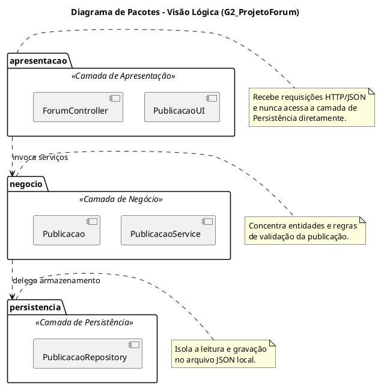
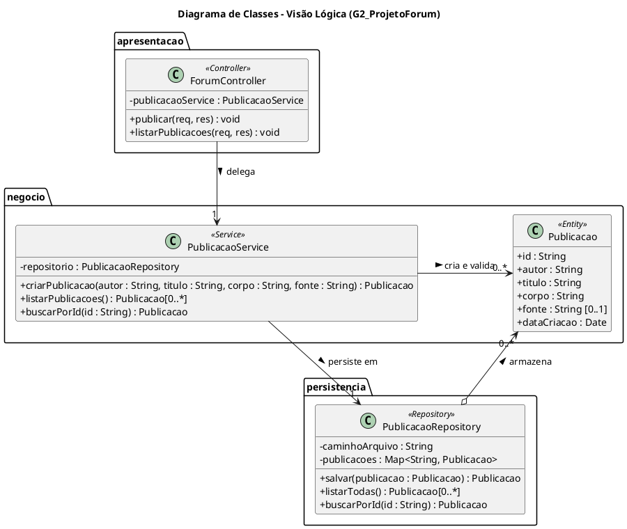
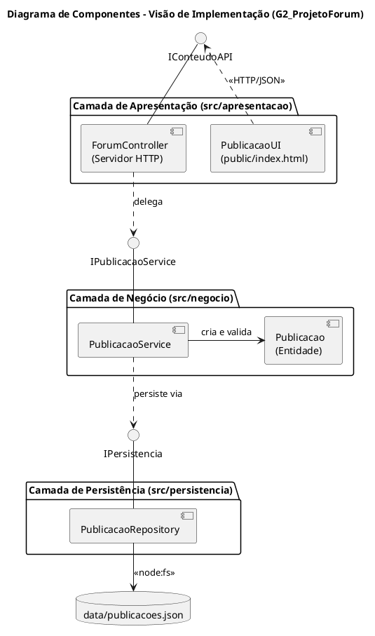

# Documento de Arquitetura (DAS)

## Focos do Relatório:
### FOCO_01: DAS

### Participantes no Foco_01
| Nome do Membro |
| :--- |
| [Guilherme Moura](https://github.com/Guilherme-Moura) |

### Metodologia do Foco_01

A elaboração deste Documento de Arquitetura de Software (DAS) seguiu uma abordagem **orientada à arquitetura (design-first)**, estruturada em três etapas sequenciais:

1. **Definição arquitetural e modelagem:** consolidação da arquitetura do **G2_ProjetoForum** com base no Modelo de Visões 4+1 (KRUCHTEN, 1995) e no template RUP adotado na disciplina, aprofundando a **Visão Lógica** (Diagrama de Pacotes e Diagrama de Classes) e a **Visão de Implementação** (Diagrama de Componentes e organização física em camadas). Os modelos foram definidos a partir da rastreabilidade com os artefatos das Entregas 2 e 3, priorizando um recorte enxuto no estilo **N-Camadas**.
2. **Implementação guiada pelos modelos:** codificação de um fluxo vertical completo — criação e listagem de publicações — em JavaScript com Node.js nativo, respeitando rigorosamente as fronteiras de dependência entre as camadas de Apresentação, Negócio e Persistência.
3. **Verificação e documentação complementar:** verificação manual do fluxo de criação e listagem de publicações na interface web e conferência do arquivo persistido, registro da execução em vídeo e documentação do uso crítico de IA Generativa nas páginas dedicadas do relatório.


---

## DAS

### 1. Introdução

#### 1.1. Propósito

Este documento apresenta uma visão arquitetural abrangente do sistema **G2_ProjetoForum**, utilizando múltiplas visões arquiteturais para descrever os aspectos lógicos e de implementação da solução. Seu propósito é registrar e comunicar as decisões arquiteturais relevantes, os estilos e padrões adotados, as fronteiras entre camadas e a rastreabilidade entre os modelos conceituais e a implementação executável.

#### 1.2. Escopo

Este DAS aplica-se ao **G2_ProjetoForum**, um sistema web de fórum voltado à publicação de conteúdos técnicos e discussão comunitária. Para comprovação arquitetural nesta etapa, o escopo concentra-se no **módulo de publicações (posts)**, cobrindo especificamente as funcionalidades de **criação e listagem de publicações** (com autor, título, corpo e fonte opcional), mantendo continuidade direta com o recorte trabalhado pela SubEquipe 03 ao longo do semestre.

#### 1.3. Definições, Acrônimos e Abreviações

| Termo / Sigla | Definição |
| :--- | :--- |
| **DAS** | Documento de Arquitetura de Software (*Software Architecture Document*). |
| **G2_ProjetoForum** | Identificação oficial do projeto de fórum desenvolvido pelo Grupo 2. |
| **GoF** | *Gang of Four* — catálogo clássico de padrões de projeto orientados a objetos (GAMMA et al., 2000). |
| **HTTP / JSON** | Protocolo de transferência de hipertexto e formato leve de troca de dados adotados na API local. |
| **MVC** | *Model-View-Controller* — padrão arquitetural que separa interface de usuário, controle de requisições e modelo de negócio. |
| **N-Camadas** | Estilo arquitetural que organiza o sistema em camadas hierárquicas com responsabilidades bem definidas e dependências controladas. |
| **RUP** | *Rational Unified Process* — processo unificado que adota o modelo de visões arquiteturais 4+1. |
| **UML** | *Unified Modeling Language* — linguagem padrão para modelagem de sistemas de software. |

#### 1.4. Referências

As fontes bibliográficas e documentais utilizadas na elaboração desta arquitetura encontram-se consolidadas na seção [Referências](/Base/Relatórios/1.1.1.DAS.md?id=referências) ao final deste relatório.

#### 1.5. Visão Geral

Este DAS segue a estrutura do template RUP: a **Seção 2** apresenta a representação arquitetural, os estilos adotados e a rastreabilidade com as entregas anteriores; a **Seção 3** detalha metas e restrições arquiteturais; a **Seção 4** descreve os casos de uso arquiteturalmente significativos; a **Seção 5** aprofunda a **Visão Lógica** (pacotes e classes); as **Seções 6 e 7** sintetizam as visões de Processos e Implantação; a **Seção 8** aprofunda a **Visão de Implementação** (componentes e camadas); a **Seção 9** descreve a Visão de Dados; e as **Seções 10 e 11** tratam de tamanho, desempenho e atributos de qualidade.

---

### 2. Representação Arquitetural

A arquitetura do **G2_ProjetoForum** é representada segundo o **Modelo de Visões 4+1** (KRUCHTEN, 1995), combinando três estilos e padrões arquiteturais complementares:

1. **Estilo Arquitetural N-Camadas (3 camadas):** estrutura o sistema em `Apresentação`, `Negócio` e `Persistência`, impondo dependências estritamente descendentes e impedindo que a interface ou o controlador acessem diretamente o armazenamento de dados.
2. **Padrão Arquitetural MVC:** aplicado na fronteira externa da aplicação, separando a interface web (*View* — `PublicacaoUI`), o controlador HTTP (*Controller* — `ForumController`) e a camada de negócio/entidades (*Model* — `PublicacaoService` e `Publicacao`).
3. **Estilo Repositório:** concentra o acesso aos dados em `PublicacaoRepository`, desacoplando as regras de negócio do mecanismo físico de persistência em arquivo JSON.

#### Visões Selecionadas

Conforme as diretrizes da entrega mínima, duas visões recebem detalhamento completo e as demais são apresentadas de forma sintética para preservar a integralidade do template RUP:

* **Visão Lógica (Seção 5):** decompõe a aplicação em pacotes lógicos e classes arquiteturalmente significativas por meio de Diagrama de Pacotes e Diagrama de Classes UML.
* **Visão de Implementação (Seção 8):** mapeia os pacotes lógicos em componentes físicos, interfaces e diretórios reais do repositório por meio de Diagrama de Componentes UML.
* **Visões de Casos de Uso, Processos, Implantação e Dados (Seções 4, 6, 7 e 9):** contextualizam os cenários executados, o modelo de execução local e o formato de persistência.

#### Rastreabilidade com Artefatos Anteriores

| Aspecto Arquitetural | [Entrega 2 (Modelagem Estática UML)](https://unbarqdsw2026-2-turma01.github.io/RepositorioTemplateEntrega2-TabNews-Forum/#/Base/Relatórios/SubEquipe_03/ModelagemEstatica) | [Entrega 3 (Modelagem GoF Observer)](https://unbarqdsw2026-2-turma01.github.io/RepositorioTemplateEntrega3-TabNews-Forum/#/Base/Relat%C3%B3rios/SubEquipe03/modelagem) | Entrega 4 (DAS — N-Camadas) |
| :--- | :--- | :--- | :--- |
| **Controlador HTTP** | `ForumController` (`publicar`, `comentar`, `avaliar`) exposto via `IConteudoAPI <<HTTP/JSON>>` | Substituído por cliente CLI (`index.js`) para isolar o padrão comportamental | Retomado como `ForumController` na camada `apresentacao`, expondo `IConteudoAPI <<HTTP/JSON>>` para criar e listar publicações |
| **Serviço de Negócio** | `ForumService` (`processarPublicacao`, `processarComentario`, `processarAvaliacao`) acoplado a `TabCoinsService` | `ServicoDeConteudo` desacoplado via padrão Observer (`Sujeito`/`Observador`) | Especializado em `PublicacaoService` na camada `negocio`, focado nas regras de criação e consulta de publicações |
| **Entidade de Domínio** | `Conteudo` (abstrata) especializada em `Publicacao` (`titulo`, `fonte`, `corpo`, `dataCriacao`) e `Comentario` | `Conteudo` unificado com controle de estado | Consolidada em `Publicacao` (`id`, `autor`, `titulo`, `corpo`, `fonte`, `dataCriacao`), omitindo `Comentario` e `Voto` por estarem fora do recorte |
| **Reações a Eventos (TabCoins e Auditoria)** | Acoplamento direto entre `ForumService` e `TabCoinsService` | Validadas em código como observadores (`ServicoDeTabCoins`, `NotificadorDeResposta`, `RegistroDeAtividades`) | Mantidas fora do recorte mínimo executável desta etapa para focar o escopo no estilo N-Camadas; a separação da camada `negocio` permite reacoplá-las futuramente sem alterar `apresentacao` nem `persistencia` |
| **Persistência** | `Repositorio` conectado ao `PostgreSQL` via `<<JDBC>>` | `RepositorioDeConteudo` em memória (`Map`) | `PublicacaoRepository` na camada `persistencia`, mantendo a interface `IPersistencia` com armazenamento em memória sincronizado em arquivo JSON local (`node:fs`) |

---

### 3. Metas e Restrições Arquiteturais

#### Metas Arquiteturais

* **Separação rigorosa de camadas:** a camada de Apresentação (`PublicacaoUI` e `ForumController`) comunica-se apenas com a camada de Negócio (`PublicacaoService`), nunca acessando diretamente a camada de Persistência (`PublicacaoRepository`).
* **Baixo acoplamento e manutenibilidade:** a substituição da interface web ou do mecanismo de persistência (por exemplo, migração de arquivo JSON para banco relacional) não deve exigir alterações nas regras de negócio.
* **Testabilidade:** as camadas de Negócio e Persistência devem ser testáveis de forma independente, inclusive com injeção de repositório em memória ou arquivo temporário, sem necessidade de subir o servidor HTTP.

#### Restrições Arquiteturais

* **Ambiente e zero dependências externas:** implementação restrita ao **Node.js (versão 18 ou superior)** utilizando exclusivamente módulos nativos (`node:http`, `node:fs`, `node:path`), garantindo reprodutibilidade local sem instalação de bibliotecas externas.
* **Persistência simplificada:** em substituição ao `PostgreSQL` (`<<JDBC>>`) previsto na modelagem conceitual da Entrega 2, utiliza-se persistência em arquivo JSON local (`data/publicacoes.json`) por tratar-se de uma prova de conceito arquitetural autônoma.
* **Escopo vertical enxuto:** prioriza-se a clareza arquitetural sobre o volume de funcionalidades, deixando autenticação (`AuthService`), árvore de comentários (`Comentario`), votação (`Voto`) e reações assíncronas fora do escopo executável desta entrega.

---

### 4. Visão de Casos de Uso

Dois casos de uso concentram o recorte arquitetural implementado e atravessam integralmente as três camadas do sistema:

* **UC01 — Criar Publicação:** um autor preenche nome de usuário, título, corpo e fonte opcional na interface web (`PublicacaoUI`). A requisição é recebida pelo `ForumController`, validada pelo `PublicacaoService`, convertida em uma entidade `Publicacao` e persistida pelo `PublicacaoRepository`.
* **UC02 — Listar Publicações:** a interface web requisita as publicações armazenadas, exibindo o histórico persistido em ordem de criação.

#### 4.1. Realizações de Casos de Uso

A realização do **UC01 (Criar Publicação)** percorre as três camadas na seguinte sequência:

1. A *View* (`PublicacaoUI`, servida a partir de `src/apresentacao/public/index.html`) envia uma requisição `POST /api/publicacoes` em formato JSON ao `ForumController`.
2. `ForumController.publicar(req, res)` interpreta o payload HTTP, delega os dados para `PublicacaoService.criarPublicacao(autor, titulo, corpo, fonte)` e trata eventuais erros de validação retornando status `400 Bad Request`.
3. `PublicacaoService` valida a obrigatoriedade de `autor`, `titulo` e `corpo`, instancia a entidade `Publicacao` e aciona `PublicacaoRepository.salvar(publicacao)`.
4. `PublicacaoRepository` gera um identificador sequencial (`p1`, `p2`, ...), armazena o registro em memória e sincroniza a coleção no arquivo `data/publicacoes.json` via `node:fs`.
5. `ForumController` devolve resposta HTTP `201 Created` contendo a publicação criada em JSON, e `PublicacaoUI` atualiza a listagem exibida ao usuário.

---

### 5. Visão Lógica

A Visão Lógica descreve a decomposição conceitual do **G2_ProjetoForum** em pacotes de camadas e apresenta as classes arquiteturalmente significativas, suas responsabilidades e relacionamentos.

#### 5.1. Visão Geral

O sistema é organizado em três pacotes lógicos no estilo **N-Camadas**, com fluxo de dependência estritamente vertical:

* **`apresentacao`:** concentra a interface web (`PublicacaoUI`) e o controlador HTTP (`ForumController`).
* **`negocio`:** concentra as regras de validação e coordenação (`PublicacaoService`) e a entidade central do domínio (`Publicacao`).
* **`persistencia`:** concentra o acesso aos dados (`PublicacaoRepository`), encapsulando leitura e gravação no sistema de arquivos.



<p align="center">Figura 1: Diagrama de Pacotes da Visão Lógica do G2_ProjetoForum. Fonte: Elaboração própria (2026).</p>

#### 5.2. Pacotes de Projeto Arquiteturalmente Significativos

O Diagrama de Classes a seguir especializa o modelo estático da Entrega 2 para o recorte vertical de criação e listagem de publicações, distribuindo as quatro classes principais nos três pacotes da arquitetura em N-Camadas.


<p align="center">Figura 2: Diagrama de Classes da Visão Lógica do G2_ProjetoForum. Fonte: Elaboração própria, adaptado da Entrega 2 (2026).</p>

##### Resumo das Classes Arquiteturalmente Significativas

| Pacote | Classe | Responsabilidade Arquitetural |
| --- | --- | --- |
| `apresentacao` | `ForumController` | Expõe o servidor HTTP nativo, interpreta requisições JSON (`POST /api/publicacoes` e `GET /api/publicacoes`), delega operações ao serviço de negócio e serializa respostas HTTP. |
| `negocio` | `PublicacaoService` | Valida campos obrigatórios (`autor`, `titulo` e `corpo`), instancia a entidade `Publicacao` e coordena persistência e consulta sem depender de detalhes de transporte HTTP ou formato de arquivo. |
| `negocio` | `Publicacao` | Representa a entidade central do domínio, mantendo os atributos `id`, `autor`, `titulo`, `corpo`, `fonte` (opcional) e `dataCriacao`. |
| `persistencia` | `PublicacaoRepository` | Gerencia a coleção de publicações em memória com persistência em `data/publicacoes.json`, atribuindo identificadores sequenciais (`p1`, `p2`, ...). |

---

### 6. Visão de Processos

O **G2_ProjetoForum** executa em um **processo único do runtime Node.js**, apoiado no *event loop* assíncrono nativo para atender conexões HTTP (`node:http`). Dentro do tratamento de cada requisição, a chamada atravessa `ForumController`, `PublicacaoService` e `PublicacaoRepository` de forma **sequencial e determinística**, eliminando complexidade de concorrência distribuída no escopo didático e garantindo previsibilidade na execução e verificação do sistema.

---

### 7. Visão de Implantação

A implantação da demonstração ocorre em um único nó local (*localhost*), dividido logicamente em três elementos:

* **Cliente (Navegador Web):** acessa `http://localhost:3001`, renderiza `PublicacaoUI` e realiza chamadas `fetch` em JSON.
* **Servidor de Aplicação (Node.js >= 18):** executa o servidor HTTP nativo na porta `3001`, hospedando as camadas de Apresentação, Negócio e Persistência.
* **Armazenamento Local (Sistema de Arquivos):** arquivo `data/publicacoes.json` mantido pelo `PublicacaoRepository` no mesmo hospedeiro.

---

### 8. Visão de Implementação

A Visão de Implementação materializa os pacotes lógicos em componentes concretos, interfaces de comunicação e diretórios físicos no repositório.

#### 8.1. Visão Geral

O Diagrama de Componentes abaixo evolui o **Diagrama de Componentes da Página da Postagem (Entrega 2)** para o recorte em 3 camadas, preservando os contratos `IConteudoAPI <<HTTP/JSON>>` e `IPersistencia`, e explicitando o fluxo linear entre Apresentação, Negócio e Persistência.



<p align="center">Figura 3: Diagrama de Componentes da Visão de Implementação do G2_ProjetoForum. Fonte: Elaboração própria, adaptado da Entrega 2 (2026).</p>

#### 8.2. Camadas

A estrutura física de diretórios do projeto espelha diretamente os componentes da Figura 3:

```text
src/
├── apresentacao/
│   ├── public/
│   │   └── index.html              # PublicacaoUI (formulário de criação e listagem de publicações)
│   └── ForumController.js          # Controlador MVC e servidor HTTP nativo (node:http)
├── negocio/
│   ├── Publicacao.js               # Entidade Publicacao
│   └── PublicacaoService.js        # Regras de validação, criação e listagem de publicações
└── persistencia/
    └── PublicacaoRepository.js     # Persistência em memória sincronizada com data/publicacoes.json
```

| Camada | Diretório | Dependências Permitidas | Regra de Fronteira |
| --- | --- | --- | --- |
| **Apresentação** | `src/apresentacao/` | `negocio`, módulos nativos (`node:http`, `node:fs`, `node:path`) | Nunca importa módulos de `src/persistencia/`. |
| **Negócio** | `src/negocio/` | `persistencia` (com suporte à injeção no construtor) | Livre de dependências de protocolo HTTP ou interface web. |
| **Persistência** | `src/persistencia/` | `negocio` (apenas a entidade `Publicacao`), módulos nativos (`node:fs`, `node:path`) | Única camada autorizada a ler e gravar arquivos de dados. |

---

### 9. Visão de Dados (Opcional)

As publicações são armazenadas como uma coleção JSON em `data/publicacoes.json`, mantendo os atributos definidos na Visão Lógica:

```json
[
  {
    "id": "p1",
    "autor": "joao",
    "titulo": "Arquitetura em N-Camadas no Node.js",
    "corpo": "Separando apresentação, negócio e persistência.",
    "fonte": "https://nodejs.org/docs/latest/api/",
    "dataCriacao": "2026-11-21T14:00:00.000Z"
  }
]

```

---

### 10. Tamanho e Desempenho

No escopo didático local, o volume previsto é reduzido (dezenas a centenas de publicações), com tempo de resposta inferior a poucos milissegundos por requisição HTTP local. Em um cenário de evolução para produção multiusuário, o estilo Repositório permite substituir `PublicacaoRepository` por uma implementação baseada em banco de dados relacional (como o `PostgreSQL` modelado na Entrega 2) mantendo intacto o contrato com `PublicacaoService`.

---

### 11. Qualidade

A arquitetura proposta favorece diretamente os seguintes atributos de qualidade:

* **Manutenibilidade:** o isolamento em três camadas reduz o impacto de alterações — mudanças na interface HTML/JS não afetam regras de validação, e mudanças no armazenamento não exigem alteração no controlador HTTP.
* **Testabilidade:** a possibilidade de injetar um repositório alternativo no construtor de `PublicacaoService` permite validar regras de negócio, persistência e fronteiras arquiteturais de forma rápida e isolada.
* **Portabilidade:** o uso exclusivo de módulos nativos do Node.js (`>= 18`) elimina problemas de compatibilidade de dependências externas em diferentes ambientes de execução.
* **Usabilidade (Design Centrado no Usuário):** a interface `PublicacaoUI` apresenta retorno imediato de validação e atualiza a listagem de publicações na mesma página logo após o envio.

---

## Documentos Complementares da Entrega

* **[Código, Execução e Vídeo de Demonstração](/Base/Relatórios/1.1.3.codigo-execucao.md):** detalhamento da implementação em N-Camadas, links para os arquivos em `src/`, instruções de execução e vídeo demonstrando a aplicação em funcionamento.
* **[IA Generativa](/Base/Relatórios/1.1.4.IA_generativa.md):** registro das lições aprendidas, análise crítica sobre o uso de IA Generativa nesta etapa e evidências correspondentes.
* **[Participações](/Base/1.2.Participacoes.md):** quadro consolidado de participação e comprobatórios da entrega.

---

## Referências

* GAMMA, Erich; HELM, Richard; JOHNSON, Ralph; VLISSIDES, John. **Padrões de Projeto: soluções reutilizáveis de software orientado a objetos**. Porto Alegre: Bookman, 2000.
* KRUCHTEN, Philippe. The 4+1 View Model of Architecture. **IEEE Software**, v. 12, n. 6, p. 42–50, nov. 1995.
* LARMAN, Craig. **Utilizando UML e Padrões: uma introdução à análise e ao projeto orientados a objetos e ao desenvolvimento iterativo**. 3. ed. Porto Alegre: Bookman, 2007.
* NODE.JS. **Node.js Documentation (HTTP e File System)**. Disponível em: [https://nodejs.org/docs/latest/api/](https://nodejs.org/docs/latest/api/). Acesso em: 21 nov. 2026.
* PLANTUML. **PlantUML Language Reference Guide**. Disponível em: [https://plantuml.com/](https://plantuml.com/). Acesso em: 21 nov. 2026.
* RATIONAL SOFTWARE CORPORATION. **Software Architecture Document (Template RUP)**. Disponível em: [https://www.dca.ufrn.br/~anderson/FTP/dca0120/modelodocarquiteturasoftware.doc](https://www.dca.ufrn.br/~anderson/FTP/dca0120/modelodocarquiteturasoftware.doc). Acesso em: 21 nov. 2026.
* SOMMERVILLE, Ian. **Engenharia de Software**. 8. ed. São Paulo: Pearson Addison Wesley, 2007.
* SUBEQUIPE_03. **Modelagem Estática na Notação UML**. Entrega 02 — G2_ProjetoForum. Brasília: UnB/FCTE, 2026. Disponível em: [https://unbarqdsw2026-2-turma01.github.io/RepositorioTemplateEntrega2-TabNews-Forum/#/Base/Relatórios/SubEquipe_03/ModelagemEstatica](https://unbarqdsw2026-2-turma01.github.io/RepositorioTemplateEntrega2-TabNews-Forum/#/Base/Relatórios/SubEquipe_03/ModelagemEstatica). Acesso em: 21 nov. 2026.
* SUBEQUIPE_03. **Modelagem do Padrão Observer**. Entrega 03 — G2_ProjetoForum. Brasília: UnB/FCTE, 2026. Disponível em: [https://unbarqdsw2026-2-turma01.github.io/RepositorioTemplateEntrega3-TabNews-Forum/#/Base/Relatórios/SubEquipe03/modelagem](https://unbarqdsw2026-2-turma01.github.io/RepositorioTemplateEntrega3-TabNews-Forum/#/Base/Relatórios/SubEquipe03/modelagem). Acesso em: 21 nov. 2026.

---

## Versionamentos
|Nome do Membro | Contribuição | Data|
| --- | --- | --- |
| [Guilherme Moura](https://github.com/Guilherme-Moura) | 1. Estruturação completa do DAS (Seções 1 a 11) no estilo N-Camadas (3 camadas), tabela de rastreabilidade com as Entregas 2 e 3, diagramas PlantUML da Visão Lógica (Pacotes e Classes) e da Visão de Implementação (Componentes) e referências. | 21/11/2026 |