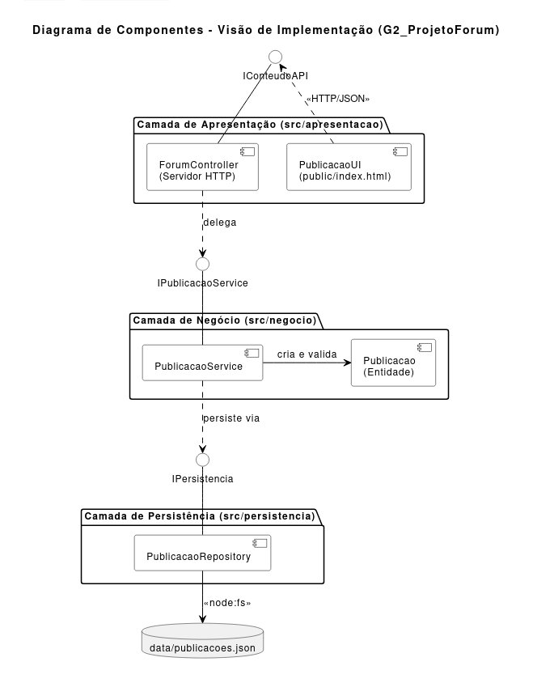
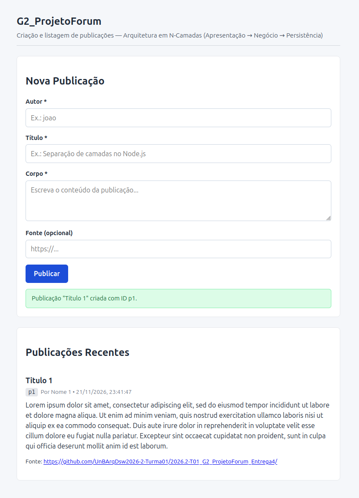

# G2_ProjetoForum

**Código da Disciplina**: FGA0208<br>
**Número do Grupo**: 02<br>
**Entrega**: 04<br>

## Alunos

| Matrícula | Aluno |
| :--- | :--- |
| 23/1012227 | Guilherme Moura da Silva Neto |

## Sobre

Este repositório reúne os artefatos da **Quarta Entrega** da disciplina Arquitetura e Desenho de Software (FGA0208 — UnB/FCTE) para o projeto **G2_ProjetoForum**, um sistema web de fórum voltado à publicação e discussão de conteúdos técnicos.

Seguindo as diretrizes do módulo de Arquitetura & Reutilização de Software, a entrega adota o foco **Documento de Arquitetura (DAS) + IA Generativa**. O documento segue o template RUP baseado no Modelo de Visões 4+1 (KRUCHTEN, 1995), aprofundando a **Visão Lógica** (Diagramas de Pacotes e Classes) e a **Visão de Implementação** (Diagrama de Componentes e organização física em camadas). Para comprovação prática, foi implementado em Node.js nativo o módulo de criação e listagem de publicações no estilo arquitetural **N-Camadas** (`Apresentação`, `Negócio` e `Persistência`), mantendo rastreabilidade com a [Entrega 2 (Modelagem Estática)](https://unbarqdsw2026-2-turma01.github.io/RepositorioTemplateEntrega2-TabNews-Forum/#/Base/Relatórios/SubEquipe_03/ModelagemEstatica) e a [Entrega 3 (Padrão Observer)](https://unbarqdsw2026-2-turma01.github.io/RepositorioTemplateEntrega3-TabNews-Forum/#/Base/Relatórios/SubEquipe03/modelagem).

## Screenshots da Quarta Entrega

<div align="center">

</div>

<p align="center">Figura 1: Diagrama de Componentes da Visão de Implementação do G2_ProjetoForum. Fonte: Elaboração própria (2026).</p>


<div align="center">

</div>

<p align="center">Figura 2: Interface web (PublicacaoUI) em execução local, demonstrando o formulário de criação e a listagem de publicações persistidas. Fonte: Elaboração própria (2026).</p>

## Há algo a ser executado?

(x) SIM

( ) NÃO

### Manual de Execução

**Pré-requisito:** Node.js versão **18 ou superior** (não há dependências externas para instalar).

1. Clone o repositório e acesse a pasta raiz do projeto.
2. Inicie o servidor local com:

```bash
   npm start

```

*(Alternativa direta: `node src/apresentacao/ForumController.js`)*

3. Abra o navegador em `http://localhost:3001` para criar e listar publicações. Os dados são persistidos automaticamente em `data/publicacoes.json`.

Mais detalhes e o vídeo de demonstração estão disponíveis em [Código e Execução](Base/Relatórios/1.1.3.codigo-execucao.md).

## Informações Complementares

- [1. Desenho de Software (DAS_Reutilização)](Base/1.DAS_Reutilizacao.md)
- [1.1.1. Documento de Arquitetura (DAS)](Base/Relatórios/1.1.1.DAS.md)
- [1.1.3. Código, Execução e Vídeo de Demonstração](Base/Relatórios/1.1.3.codigo-execucao.md)
- [1.1.4. IA Generativa](Base/Relatórios/1.1.4.IA_generativa.md)
- [1.2. Participações](Base/1.2.Participacoes.md)